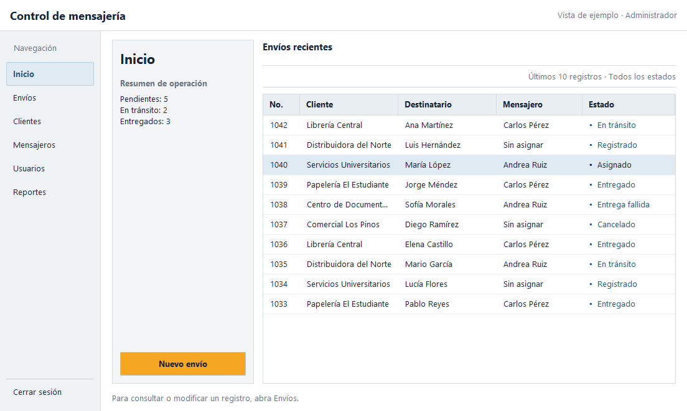
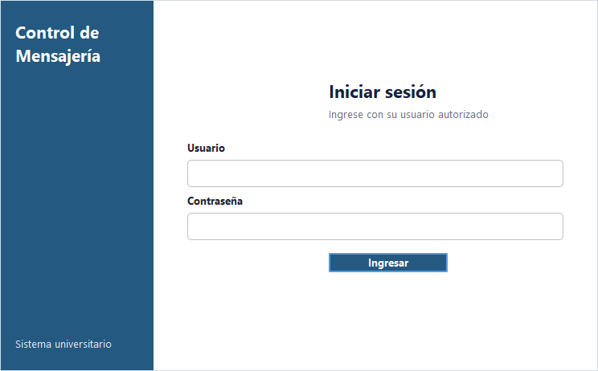

# Revisión visual y propuesta por etapas

Fecha: 23 de octubre de 2026.

## Alcance y evidencia

Se revisaron los nueve pares `.java` / `.form`, los estilos compartidos y las capturas
generadas con `FormSmokeCheck` después de compilar las fuentes actuales. Las capturas
base están en `target/design-review/before/`. No se consultó ni modificó Oracle.
Las capturas sin datos permiten evaluar distribución; los estados redondeados y las
tarjetas de Inicio también se analizaron en sus renderizadores y código de creación.

La imagen adjunta de «Manage Students» es la referencia solicitada: muestra el
formulario de registro a la izquierda y la búsqueda con un listado amplio a la
derecha. Tomo esa jerarquía y relación directa entre datos y tabla como guía. No
copio su encabezado desproporcionado, las filas demasiado bajas ni los botones con
iconos de estilos distintos; adapto las proporciones y tipografía al sistema.

## Problemas concretos

1. **Principal (`MainFrame`).** Cabecera con márgenes de 34/44 px y título de 26 pt:
   desplaza el área útil hacia abajo. Lateral oscuro de 224 px con acciones de 44 px,
   sin separar la salida de los módulos. Naranja tanto en Inicio como en Nuevo envío.
   Tabla sin título ni explicación del límite de diez registros. Columnas iguales
   para número, nombres y estado. Selección naranja y estados en pastillas. El
   contador de pendientes incluye los envíos en tránsito, relación no explicada.
2. **Inicio (`InicioFrame`).** Duplica parte del resumen del principal. Seis tarjetas
   en una única fila, números de 34 pt y 108 px de altura: todos los estados reciben
   el mismo peso. El saludo añade altura sin ayudar a resolver una tarea. Pulsar
   cualquier tarjeta abre Envíos sin filtrar por el estado pulsado; su presentación
   sugiere una precisión que la acción actual no ofrece.
3. **Usuarios.** Panel fijo de 350 px frente a una tabla de solo cuatro columnas.
   Cuatro botones anchos apilados. Crear cuenta, editar rol/estado y cambiar clave
   comparten la misma zona, y la contraseña sirve para dos operaciones distintas.
   La distribución no hace evidente si se está creando o editando una cuenta.
4. **Clientes.** Panel fijo de 330 px con mucho espacio sobrante inferior. Dirección
   en una sola línea y columnas con anchuras parecidas para nombre, teléfono,
   dirección y correo. Botones apilados de igual tamaño que restan jerarquía.
5. **Mensajeros.** Repite casi exactamente Clientes. Para el operador permanece
   un formulario de edición deshabilitado con un aviso, pese a ser una consulta.
   El estado activo/inactivo no tiene una zona clara en la ficha. Conviene preservar
   el aviso de permisos, acercándolo a las acciones que explica.
6. **Envíos.** Búsqueda y acciones ocupan dos bandas amplias. Ocho columnas con
   anchuras poco diferenciadas, aunque descripción y destinatario necesitan más
   espacio. El detalle de texto tiene una altura fija de 120 px, poco adaptable
   a distintas cantidades de información. Las pastillas reducen el espacio del
   texto; la selección naranja compite con Nuevo envío.
7. **Nuevo envío.** `GridLayout(0, 2)` impone el mismo tamaño a cada celda. Peso y
   dimensiones reciben tanto ancho como dirección y descripción. Falta agrupar
   remitente, paquete y destino. Teléfono del destinatario y mensajero aparecen
   juntos por posición, sin que pertenezcan a la misma tarea.
8. **Reportes.** Ocho columnas casi uniformes. El selector y Generar PDF comparten
   fila, mientras el total queda lejos de la exportación. Falta jerarquía entre
   criterios, resultado y salida. No necesita tarjetas de indicadores.
9. **Acceso.** Ventana de 900 × 580 para dos campos; la marca ocupa la mitad y el
   `GridLayout` otorga una altura excesiva al botón. Una ventana menor facilitaría
   la lectura de errores junto al formulario.
10. **Historial.** No hay formulario, entrada de menú ni registro de transiciones
    en el código y SQL revisados. Los envíos conservan estado actual y datos de
    entrega; no permiten reconstruir por sí solos todas las transiciones.

## Distribución propuesta

| Módulo | Organización | Motivo |
|---|---|---|
| Principal / Inicio | Cabecera de aplicación, navegación de 162 px, ficha de resumen y acción Nuevo envío a la izquierda; tabla de recientes a la derecha y ayuda inferior. Para InicioFrame, sustituir las seis tarjetas por un resumen compacto y conservar la lista de pendientes. | Reproducir la jerarquía formulario/listado de la referencia con datos y acciones existentes. |
| Usuarios | Listado a la izquierda; editor compacto a la derecha con grupos Cuenta, Permisos y Contraseña. Acciones junto a su grupo y modo de edición visible. | Separar operaciones distintas sin cambiar validaciones ni permisos. |
| Clientes | Búsqueda y tabla en la parte superior; ficha inferior ajustable con nombre/teléfono y dirección/correo, seguida de acciones. | Ofrecer mayor anchura a datos de contacto y evitar una columna de formulario vacía. |
| Mensajeros | Listado predominante y ficha lateral de unos 300 px. Nombre, contacto y estado en grupos compactos; aviso de consulta junto a las acciones. | Consulta rápida y distinción clara de permisos. |
| Envíos | Barra compacta de búsqueda/estado; acciones contextuales; tabla y detalle inferior unidos con JSplitPane. | Ajustar espacio de listado y detalle a la tarea. Mantener los ocho datos y las acciones existentes. |
| Nuevo envío | Grupos Remitente, Paquete, Destino y Asignación. Peso/dimensiones en campos cortos; dirección y descripción a ancho completo; observaciones con varias líneas. | La longitud y relación de los campos deben determinar su disposición. |
| Historial | Propuesta futura: búsqueda de envío y listado de consulta; detalle cronológico del seleccionado con fecha, estado y observación, únicamente si esos datos existen. | No inventar una auditoría a partir del estado actual. Cualquier persistencia adicional sería otro alcance, no un cambio visual. |
| Reportes | Criterios arriba, tabla como vista previa dominante, total y Generar PDF en una barra inferior. | Distinguir selección, revisión y exportación. Mantener los tipos de reporte actuales. |

## Criterios visuales

- Blanco para datos; gris claro para navegación y bandas de herramientas; azul para
  jerarquía y selección. Naranja solo en la acción destacada.
- Texto base de 13 pt; título de módulo de 22 pt; etiquetas legibles. Márgenes de
  trabajo de 18–22 px y separación de 10–16 px, evitando contenedores superpuestos.
- Filas de 32 px, encabezados de 34 px y selección azul tenue. Número estrecho;
  nombres y descripciones con mayor anchura. Texto completo disponible en tooltip.
- Estados como texto y marcador pequeño, sin fondos redondeados ni depender del color.
- Botones de 36–38 px con esquinas discretas; conservar foco visible y navegación
  por teclado. No añadir gráficos, métricas o controles sin datos o acciones reales.

## Rediseño implementado

- `MainFrame`: adapta la referencia con navegación a la izquierda, ficha compacta
  de resumen y acción, y la tabla dominante a la derecha.
- `LoginFrame`: mantiene el acceso en una ventana compacta con identificación
  lateral y campos amplios.
- `InicioFrame`: reemplaza las tarjetas por indicadores de texto y conserva la tabla
  de envíos pendientes recientes.
- `ClienteFrame` y `MensajeroFrame`: conservan la ficha de edición, reducen su ancho,
  agrupan las acciones en dos columnas y dan el resto del espacio al listado.
- `UsuarioFrame`: mantiene la tabla dominante, con ficha de administración y acciones
  agrupadas en dos columnas.
- `EnvioFrame`: añade una división ajustable entre el listado y el detalle; da mayor
  ancho a cliente, descripción y destinatario.
- `NuevoEnvioFrame`: agrupa cliente, contenido y entrega; asigna todo el ancho a
  descripción y dirección, y mantiene observaciones dentro del formulario desplazable.
- `ReporteFrame`: criterios arriba, tabla amplia con desplazamiento horizontal y
  total/exportación en el pie.
- `Estilo`: unifica encabezados claros, selección azul tenue, alturas de fila y
  marcadores sencillos para estados.

Los nueve `.form` y sus bloques generados `initComponents()` están sincronizados.
La jerarquía de paneles, layouts, campos, botones, tamaños, colores, fuentes y
bordes pertenece ahora a Design. Se retiraron los métodos que reconstruían las
ventanas después de `initComponents()`. Los espacios del acceso y del menú son
paneles transparentes editables en el diseñador, sin componentes externos.

Se conservan eventos, consultas, permisos, validaciones, autenticación, conexiones
y dependencias de Maven. Los constructores siguen enlazando modelos, escuchas,
permisos y renderizadores de tablas; estos últimos y los datos de sesión se aplican
al ejecutar. Los contadores de Inicio se generan con el resultado de la consulta.
El Look and Feel del IDE puede producir pequeñas diferencias en controles nativos.

Para editar una pantalla, abrir su archivo Java y seleccionar **Design**. Si estaba
abierta antes de la sincronización, aceptar la recarga del archivo modificado;
si conserva una vista anterior, cerrar esa pestaña y abrirla nuevamente. Editar
propiedades y distribución desde Design para que NetBeans mantenga ambos archivos.
No modificar manualmente los bloques delimitados por `GEN-BEGIN` y `GEN-END`.

Historial continúa como propuesta futura: el esquema y las clases actuales conservan
el estado vigente del envío, no una bitácora de transiciones. Mostrar ese estado como
si fuera un historial cronológico resultaría engañoso; almacenar transiciones
requeriría cambios funcionales y de esquema fuera de este rediseño visual.

## Verificación

- Maven `-o package`: **BUILD SUCCESS** para Java 17.
- `FormSmokeCheck`: **OK**, nueve formularios, controles, permisos y ciclo de ventanas.
- Las capturas de `target/ui-preview/` se generaron sin Oracle; la vista previa
  del principal usa diez envíos ficticios.
- `FormDesignCheck`: compara los nueve `.form` con las instancias Java, incluyendo
  234 controles, jerarquías, orden, layouts, restricciones y propiedades visuales.
  Verifica también que los manejadores declarados existen y no se duplican.
- Los `.form` y bloques generados cambiaron juntos; se preservaron los manejadores
  de eventos. No se probó conexión ni operaciones con Oracle.

Después de `mvn -o package`, ejecutar las comprobaciones sin acceder a Oracle:

```powershell
java -cp "target/test-classes;target/SistemaMensajeria-1.0.jar" com.mensajeria.ui.FormDesignCheck
java -cp "target/test-classes;target/SistemaMensajeria-1.0.jar" com.mensajeria.ui.FormSmokeCheck
```




